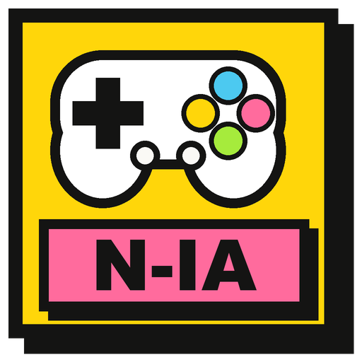

<!--
# SPDX-FileCopyrightText: Copyright 2025 Eden Emulator Project
# SPDX-License-Identifier: GPL-3.0-or-later

# SPDX-FileCopyrightText: 2018 yuzu Emulator Project
# SPDX-License-Identifier: GPL-2.0-or-later
-->

<p align="center">
  
</p>

# NS2-IA — Nintendo Switch 2 Achado IA

O **NS2-IA** é um emulador experimental de Nintendo Switch / Switch 2, **todo em português** e
otimizado para placas **AMD**. É um fork do [Fritchii](https://github.com/Frizti/Fritchii), que por
sua vez vem do Lichii, Eden e yuzu. Mantido pelo canal **Achado IA**.

> Projeto independente, sem ligação com a Nintendo nem com os projetos de origem.
> **Não vem com jogos, chaves (prod.keys) nem firmware.** Use só cópias que você extraiu do seu
> próprio console.

## O que o NS2-IA traz a mais

- **Interface em português (pt-BR)** e visual escuro neobrutalista da Achado IA.
- **Notas do Zelda (F7)**: janela com o mapa de cada área de *Ocarina of Time* (Switch 2), com as
  Skulltulas Douradas, Pedaços e Recipientes de Coração, baús, rupias prateadas e paredes rachadas.
  Marca sozinha o que você já pegou, lendo o save do jogo. Os mapas e os dados são gerados a partir do
  RomFS **do seu próprio jogo**, por isso nada do jogo vem neste repositório.
- **Microfone do Switch 2**, para tocar a ocarina com a voz no *Ocarina of Time* (portado do Lichii).
- **Correção para placas AMD** do risco colorido no contorno das montanhas (Fritchii PR #29 / Lichii #353).
- Reaproveita os caches de shader do Fritchii oficial.

## Compilar (Windows, MSYS2 UCRT64)

Requer o [MSYS2](https://www.msys2.org/) no ambiente **UCRT64** com clang, cmake, ninja e Qt 6
(`qt6-base`, `qt6-svg`, `qt6-tools`, `qt6-declarative`). Detalhes do build herdado em
[docs/Build.md](docs/Build.md).

```bash
bash ns2/compilar.sh    # traduções + configurar + compilar em build/ns2
bash ns2/empacotar.sh   # gera a pasta pronta com o NS2-IA.exe e as DLLs
bash ns2/atualizar.sh   # traz a versão mais nova do Fritchii e reaplica as mudanças do NS2-IA
```

Mais detalhes em [ns2/LEIA-ME.md](ns2/LEIA-ME.md). Internamente o alvo de compilação ainda se chama
`yuzu` e algumas pastas mantêm os nomes de origem.

## Relatar problemas

Abra uma *issue* com: versão do NS2-IA, jogo e versão do jogo, processador, placa de vídeo e driver,
o que aconteceu e como repetir, e o log (`%APPDATA%\eden\log`). **Nunca envie arquivos de jogo,
chaves, firmware ou dados da sua conta.**

## Créditos e licença

O NS2-IA existe graças ao trabalho de **Frizti** ([Fritchii](https://github.com/Frizti/Fritchii)),
**zortos293** e colaboradores ([Lichii / Eglantine](https://github.com/zortos293/Eglantine)), e das
equipes **Eden**, **yuzu** e **Sudachi**. Os avisos de copyright originais e as licenças de terceiros
foram mantidos. O README original do Lichii está em [docs/README-Lichii.md](docs/README-Lichii.md).

Licença: GPL-3.0-or-later. Veja [LICENSE.txt](LICENSE.txt) e a pasta [LICENSES](LICENSES).
